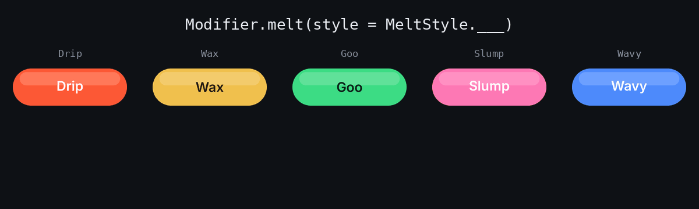
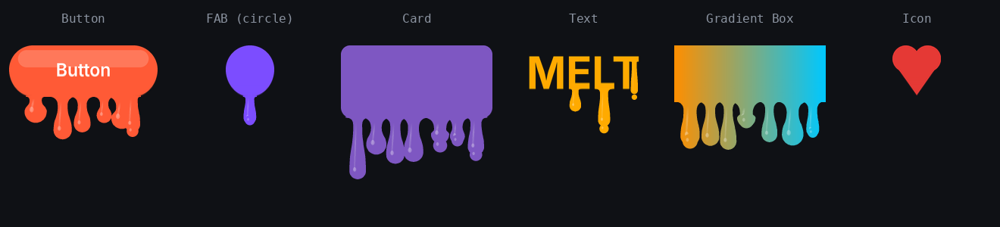

# compose-melt 🫠

[](https://github.com/gbilgeturk/compose-melt/actions/workflows/build.yml)
[](https://jitpack.io/#gbilgeturk/compose-melt)
[](LICENSE)
[](https://android-arsenal.com/api?level=21)

A Jetpack Compose `Modifier` that makes **any** composable melt and drip downward.

```kotlin
Button(onClick = {}, modifier = Modifier.melt()) {
    Text("I'm melting")
}
```

That's it. Every parameter has a default, so you only pass what you want to change.



## Installation

compose-melt is distributed through [JitPack](https://jitpack.io).

**1. Add the JitPack repository** in `settings.gradle.kts`:

```kotlin
dependencyResolutionManagement {
    repositories {
        google()
        mavenCentral()
        maven { url = uri("https://jitpack.io") }
    }
}
```

**2. Add the dependency:**

```kotlin
dependencies {
    implementation("com.github.gbilgeturk:compose-melt:0.1.0")
}
```

Requires Compose UI 1.7+ and minSdk 21.

## Usage

### Style — the shape of the melt

```kotlin
Modifier.melt(style = MeltStyle.Wax)
```

| Style | Looks like |
|---|---|
| `MeltStyle.Drip` *(default)* | Glossy paint drips with round heads, a few drops fall off |
| `MeltStyle.Wax` | A few thick, slow, matte candle-wax drips |
| `MeltStyle.Goo` | Many long, shiny slime drips with fat heads |
| `MeltStyle.Slump` | The body sags and short, wide lobes merge, like soft ice cream |
| `MeltStyle.Wavy` | Drips that bend sideways as they run |

Every style is a data class, so you can tweak a preset or build your own:

```kotlin
Modifier.melt(style = MeltStyle.Goo.copy(dripCount = 14, droplets = false))

Modifier.melt(
    style = MeltStyle(
        dripCount = 5,          // drips across the width
        dripLength = 1.2f,      // longest drip, fraction of the composable's height
        dripWidth = 0.7f,       // thickness, fraction of the space per drip (1 = drips touch)
        lengthVariance = 0.6f,  // 0 = all drips equal, 1 = very uneven
        bulb = 1.6f,            // round head size relative to thickness (1 = no bulge)
        fillet = 1.4f,          // how softly drips flare out of the bottom edge
        stagger = 0.4f,         // 0 = all drips start together
        droplets = true,        // some drips let a drop fall off their tip
        wobble = 4f,            // sideways bend in dp
        sag = 0.06f,            // how much the body itself sags
        gloss = 1f,             // liquid highlights, 0 = flat
    )
)
```

### Speed

```kotlin
Modifier.melt(speed = MeltSpeed.Fast)
Modifier.melt(speed = MeltSpeed(durationMillis = 800))
```

Presets: `Slow` (4 s), `Normal` (2.4 s, default), `Fast` (1.2 s), `VeryFast` (0.6 s).

### Melt on demand

```kotlin
var melted by remember { mutableStateOf(false) }

Button(
    onClick = { melted = !melted },
    modifier = Modifier.melt(enabled = melted),
) { Text("Tap me") }
```

`enabled = false` un-melts the composable, `true` melts it again.

### Behaviour

```kotlin
Modifier.melt(
    config = MeltConfig(
        delayMillis = 300,
        easing = LinearEasing,       // default; each drip eases on its own
        repeat = MeltRepeat.Reverse, // Once (default), Restart, Reverse
        seed = 7,                    // different seeds = different drip patterns
        respectReducedMotion = true, // stay intact when system animations are off
    )
)
```

## Works on any composable



`melt()` measures the content's **real bottom outline**, column by column, so drips hang from wherever there is actually something to drip from: the flat bottom of a button or card, the lowest point of a circular FAB, the bottoms of the letters of a `Text`. Each drip takes the colour of the content directly above it. Where the outline curves away steeply (a pill's ends, a circle's sides) or comes to a point (a heart icon), no drip forms there; the body still sags.

```kotlin
Button(modifier = Modifier.melt(), onClick = {}) { Text("Button") }
Card(Modifier.melt()) { /* ... */ }
FloatingActionButton(modifier = Modifier.melt(), onClick = {}) { Icon(...) }
Text("MELT", Modifier.melt(), fontSize = 44.sp)
Image(painter, null, Modifier.melt())
Box(Modifier.melt().background(brush, RoundedCornerShape(16.dp))) { /* ... */ }
```

## How it works

- Implemented with the `Modifier.Node` API. The animation runs in the node's own coroutine scope and only invalidates the **draw** phase: no recomposition, no relayout.
- The content is recorded into a `GraphicsLayer`; its lower half is drawn slightly stretched, so the body itself sags.
- Each drip lives through three phases driven by smoothstep curves of its own local time: a bump **gathers** at the bottom edge, the drip **flows** down (slow, faster, settling) while thinning and growing a heavy head, and some drips **release** a drop that falls with gravity and fades. Every shape and speed is continuous, so nothing pops in between frames.
- The drips are one anti-aliased `Path` (fillet, column, teardrop head), filled with a 1 px snapshot of the content's bottom edge used as a clamped image shader. Every drip takes the colour of the content right above it, gradients included.
- A soft light streak and a subtle specular highlight give the liquid volume.
- No shaders, so it looks the same on every API level from 21 up.

## Good to know

- The effect is **visual only**. Layout size and touch area don't change.
- Drips are drawn **below** the composable's bounds. If a parent uses `Modifier.clip` (or a clipping container), the drips will be cut off. Leave some space below melting items.
- **Modifier order matters.** `melt()` melts what is drawn *after* it in the chain. `Modifier.melt().background(...)` melts the background too; `Modifier.background(...).melt()` only melts the content. Composables that take a `modifier` parameter (`Button`, `Card`, `FloatingActionButton`, ...) apply it outermost, so `Modifier.melt()` melts the whole thing.
- **Siblings drawn later cover the drips.** In a `Column`, the next item is drawn on top of the drips hanging into its space. Give the melting item `Modifier.zIndex(1f)` if it should drip *over* what's below.
- Drip colours come from a snapshot taken when the melt starts. If the content's colours change mid-melt, the body updates but the drips keep their colour until it melts again.

## Sample app

The `sample` module has every style and speed side by side:

```bash
./gradlew :sample:installDebug
```

## Contributing

Bug reports, ideas and pull requests are welcome. Please read [CONTRIBUTING.md](CONTRIBUTING.md) first. Changes are listed in [CHANGELOG.md](CHANGELOG.md).

## License

```
Copyright 2026 The compose-melt Authors

Licensed under the Apache License, Version 2.0
```

See [LICENSE](LICENSE).
